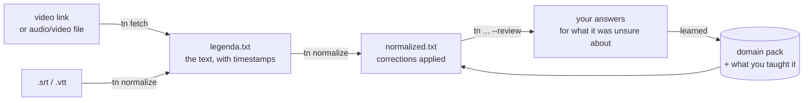
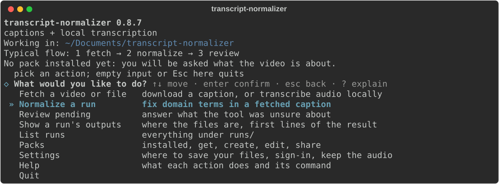
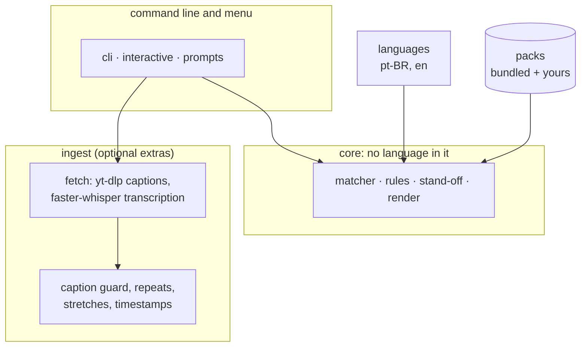

# transcript-normalizer

**Fixes the domain terms that captions and speech recognition get wrong.** Company names, acronyms, indicators and units, matched against a pack of terms for your field, without ever touching the original text.

[](https://github.com/Tatiwel/transcript-normalizer/actions/workflows/ci.yml)
[](https://github.com/Tatiwel/transcript-normalizer/releases/latest)

[](LICENSE)

## What it does

A real stretch of a Brazilian Portuguese finance video, as the platform captioned it and as the tool left it:

| time | caption | normalized |
|---|---|---|
| 0:03 | **SEMIG** ou CPFL? | **CEMIG** ou CPFL? |
| 0:16 | **Transfão** Paulista, CPFL, **CMIG**, Auren | **Transmissão** Paulista, CPFL, **CEMIG**, Auren |
| 4:30 | qual que é o **ebítica** da | qual que é o **EBITDA** da |
| 21:06 | tem que fazer **valoristo** pro fluxo de | tem que fazer **valuation** pro fluxo de |
| 27:57 | o que o **Waren Buff** usa | o que o **Warren Buffett** usa |

A spell checker cannot do this: half of these errors are real words. The tool asks a different question, *does this stretch sound like a term I know?*, and only for the terms of the pack you chose. Everything else is left alone, so a finance pack cannot damage a biology lecture.



- **The original is never changed.** Corrections are a separate layer that points into the text; `legenda.txt` stays as it came, and every timestamp is kept.
- **It asks when it is unsure.** Close guesses go to a review, one stop per form, with a link to that moment of the video. What you answer is learned for the next video.
- **Captions or local transcription.** `fetch` takes the platform's caption; where there is none, it transcribes the audio on your computer with faster-whisper. No AI provider fills gaps with plausible text.

## The menu

Run it with no arguments and it opens a menu: arrow keys, enter, esc to go back, `?` to explain any item.



## Get it

| you want to | do this |
|---|---|
| **just use it** | download the program for your system from [Releases](https://github.com/Tatiwel/transcript-normalizer/releases/latest) and open it. `lite` reads captions; `full` also transcribes audio |
| **use it from Python** | `pip install "transcript-normalizer[ingest] @ git+https://github.com/Tatiwel/transcript-normalizer@v0.8.6"` |
| **add it to your project** | see [Use it in another project](#use-it-in-another-project) |
| **work on it** | `git clone` this repository, `uv sync`, `uv run pytest -q`, then [CONTRIBUTING.md](CONTRIBUTING.md) |

Installed with pip or uv, it gives two commands that do the same thing: `transcript-normalizer` and its short name, `tn`. No ffmpeg is needed.

## Commands

**Get a text**

| command | what it does |
|---|---|
| `tn fetch <url>` | the platform's caption; local transcription where there is none (`--whisper` goes straight to it) |
| `tn fetch <file>` | transcribe an audio or video file on your computer |
| `tn fetch <url> --list` | check a link first: site, captions, audio, whether it needs a login |
| `tn fetch <file> --recheck` | for a text already there: transcribe again, alone, the stretch around a passage written twice |
| `tn restamp <run>` | rewrite an older text's timestamps as a player shows them (`1:14:14`, not `74:14`) |

**Normalize and review**

| command | what it does |
|---|---|
| `tn <legenda.txt>` | fix the domain terms (same as `tn normalize`); a `.srt` or `.vtt` is converted first |
| `tn <legenda.txt> --review` | answer what it was unsure about, one stop per form, in the order of the video |
| `tn <legenda.txt> --pack <pack>` | use another pack than the default |
| `tn list` | every run, with its date and title |

**Packs**: the vocabulary of a field

| command | what it does |
|---|---|
| `tn pack list` | installed, included and available packs |
| `tn pack install <name>` / `update` | get one from the [packs repository](https://github.com/Tatiwel/transcript-normalizer-packs), keep them current |
| `tn pack create --template <field> --name <n> --lang <l>` | start a pack for a field with none yet |
| `tn pack add-term` / `edit-term` / `remove-term` | edit a pack of your own |
| `tn pack merge <name>` | bring a newer upstream version into your copy |
| `tn pack propose` | offer what your reviews taught the tool back, as an issue |

**The tool itself**

| command | what it does |
|---|---|
| `tn update` | the version installed, the latest release, and what changed between them |
| `tn upgrade` | install the latest release, the way this copy was installed |
| `tn help` | every command and option; `tn <command> --help` for one |

## Use it in another project

A project that runs the tool lists it as a dependency, pinned to a release tag. With [uv](https://docs.astral.sh/uv/):

```
uv add "transcript-normalizer[ingest] @ git+https://github.com/Tatiwel/transcript-normalizer@v0.8.6"
```

That writes the pin to the project's `pyproject.toml` and the exact build to `uv.lock`, so every machine installs the same thing. Leave out `[ingest]` to get the normalizer alone, a few MB, for captions you already have; `[captions]` adds `fetch` with platform captions only.

To move to a newer release, run the tool through the project's own environment:

```
uv run tn update     # what the new release brings
uv run tn upgrade    # moves the pin and uv.lock to it (uv add, keeping your extras)
```

A release is a tag that passed the test suite on Linux, Windows and macOS, Python 3.11 and 3.12, before anything was built. Packs are separate files: `tn pack update` keeps those current.

## How it is built



```
src/transcript_normalizer/
  core/        the engine: pack, rules, text, matcher, stand-off layer, render
  languages/   one module per language: normalization, inflection, units
  ingest/      fetching captions and transcribing audio (the ingest extra)
  packs/       the curated packs shipped with the program
packs/         your packs and what you taught the tool
runs/<id>/     everything a command produces for one video
  legenda.txt      the text as it came, with a header saying where it came from
  normalized.txt   the same lines with the corrections applied
  annotations.json every correction, as data
  needs-review/    what needs your answer
fixtures/      frozen test material, measured on every change
docs/          the guide and every decision, with its reasons
```

## How good is it

Measured on four Brazilian Portuguese finance videos, each with a hand-checked list of every term error, against the pack shipped with the program (financas-ptbr 0.4.1):

| video | errors in scope | fixed | false positives |
|---|---|---|---|
| fixture0001 | 167 | 119 | 12 |
| fixture0002 | 222 | 168 | 3 |
| fixture0003 | 119 | 101 | 3 |
| fixture0004 | 45 | 40 | 2 |

`uv run python scripts/measure.py` prints these numbers from the fixtures; if this table disagrees with it, the script is right.

## Learn more

- [The guide](docs/GUIDE.md): installing, a first run, reading the outputs, reviewing, writing a pack for your own field.
- [Decisions](docs/DECISIONS.md): every choice, numbered, with the reasons and the measurements behind it.
- [Contributing](CONTRIBUTING.md): adding a language, building a pack, building a fixture that measures it. To report a vulnerability, see [SECURITY.md](SECURITY.md).

Built on RapidFuzz (string similarity), SymSpell LookupCompound (word boundary errors), yt-dlp and faster-whisper. MIT license.
